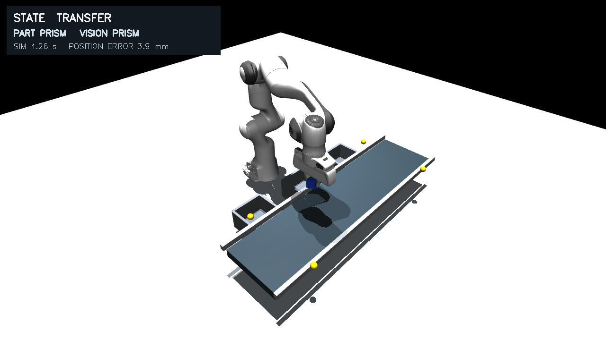

# 基于机器视觉的间歇式物料传输线零件识别与抓取系统

本仓库包含双指夹爪版程序、Panda 模型、实验输出和 LaTeX 报告。

## 抓取演示

点击画面查看对应的 MP4。视频展示了识别、夹取和分类投放过程。

| 立方体 | 圆柱体 | 三棱柱 |
| :---: | :---: | :---: |
| [](outputs/gripper_demo_cube/demo.mp4) | [](outputs/gripper_demo_cylinder/demo.mp4) | [](outputs/gripper_demo_prism/demo.mp4) |

## 报告

报告源文件为 `report/report.tex`，导出稿为 `report/report.pdf`。实验数值集中在 `report/results.tex`，插图读取 `../outputs/gripper_*/`。保留现有目录结构，可用 XeLaTeX 或 Tectonic 编译。

## 程序与数据

- `src/conveyor/`：场景、RGB 视觉、控制、实验统计和媒体导出程序。
- `outputs/gripper_*/`：三类夹爪演示及主实验、真值、带速和光照对照的 MP4、PNG、CSV、JSON。
- `third_party/mujoco_menagerie/franka_emika_panda/`：Panda 原始模型、网格和许可证；署名见 `THIRD_PARTY.md`。
- `requirements-full.txt`：在 Windows 主机上验证过的 Python 依赖版本。

激活 Python 3.10 环境后，在仓库根目录运行以下命令。依赖安装在本目录的 `.deps`，随后运行一个立方体抓取回合：

```powershell
python -m pip install --target .deps --no-cache-dir -r requirements-full.txt
$env:PYTHONPATH = (Resolve-Path .\.deps).Path + ';' + (Resolve-Path .\src).Path
python -m conveyor.cli demo --kind cube --seed 11 --output outputs/gripper_demo_cube_recheck
```

MuJoCo 离屏渲染需要可用的图形驱动。

## 实验结果

主实验共 90 次：识别 90/90、抬升 90/90、正确入箱 87/90，平面定位平均误差 2.75 mm，平均周期 10.85 s。平均周期高于 8 s 的设计目标。三棱柱有 3 次投放失败，部分回合转动较大。实验场景为单件、颜色分明且瞬时停带的 MuJoCo 仿真。
